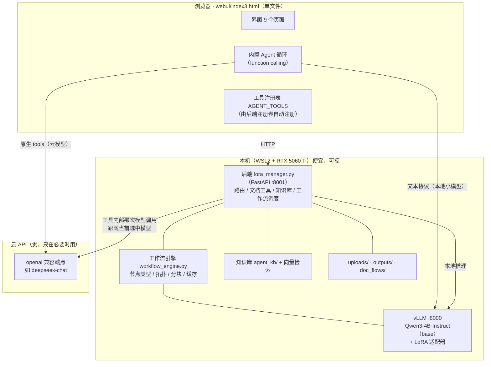
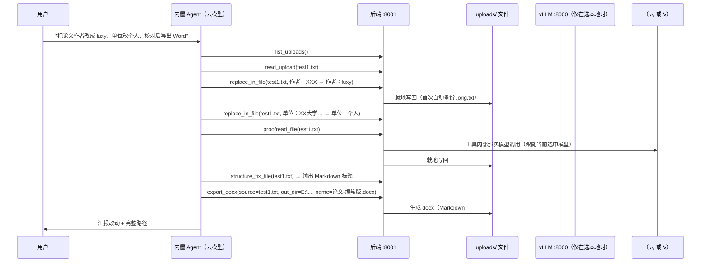
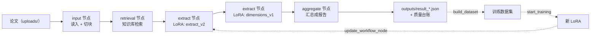

# 架构图（云边分工 · LoRA 挂在哪 · 数据流）

## 一、总览



## 二、云边分工（省钱的根据）

| 环节 | 放哪 | 为什么 |
|---|---|---|
| **抽取 / 维度归纳**（工作流主力） | **本地 LoRA**（`extract_v2`、`dimensions_v1`） | 量大、可缓存、不需要云端智能 |
| **格式规范化**（`format_fix`） | **规则**（零模型） | 确定性、毫秒级、可复现 |
| **校对 / 术语 / 逻辑 / 翻译** | 取决于**当前选中的模型** | 选了云就用云；选本地就本地 |
| **Agent 的决策与工具选择** | 当前选中的模型 | 云模型明显更强（本地 4B 会退化成复述原文）|
| **文档读写 / 表格 / 导出** | **纯本地代码**（python-docx / openpyxl） | 不需要模型 |

**实测**：云端 token 中位 **30896 → 8198（−73.5%）**（趋势对照，限界见 `docs/BASELINE.md`）。

## 三、LoRA 挂在哪

```
vLLM 启动: --enable-lora --max-loras 2 --max-lora-rank 128 --max-model-len 32768
                    │
                    ├── base: Qwen3-4B-Instruct（FP16）
                    └── LoRA 适配器（按需热插拔，最多同时 2 个）
                          · extract_v2 / dimensions_v1   ← 生产用
                          · 其余为实验版（见 /loras）
```

- LoRA 是**挂在 vLLM 上**，不是挂在 FastAPI 上：`/loras/load` 调 vLLM 的 LoRA 接口。
- 工作流的**节点**通过 `lora` 字段指定用哪个适配器（`extract` 类节点）。
- **节点换 LoRA 不用重跑整条链**：Agent 里就是 `update_workflow_node(id, {lora: ...})`。

## 四、一次"文档编辑任务"的数据流（实测链路）



## 五、一次"论文分析工作流"的数据流



## 六、部署形态与端口

| 组件 | 端口 | 启动方式 |
|---|---|---|
| vLLM 底座 | 8000 | `scripts/start.sh`（异步加载）或「🎛️ 底座管理」页 |
| 后端 | 8001 | `scripts/start.sh` |
| 前端 | 8080 | `scripts/start.sh`（`python -m http.server`，纯静态） |

```
一键启动: 双击 启动工作台.bat（桌面 / E:\WSL\ / 仓库根目录 各一份）
停止:     双击 停止工作台.bat（默认保留底座）；全停用 scripts/stop.sh --all
```
